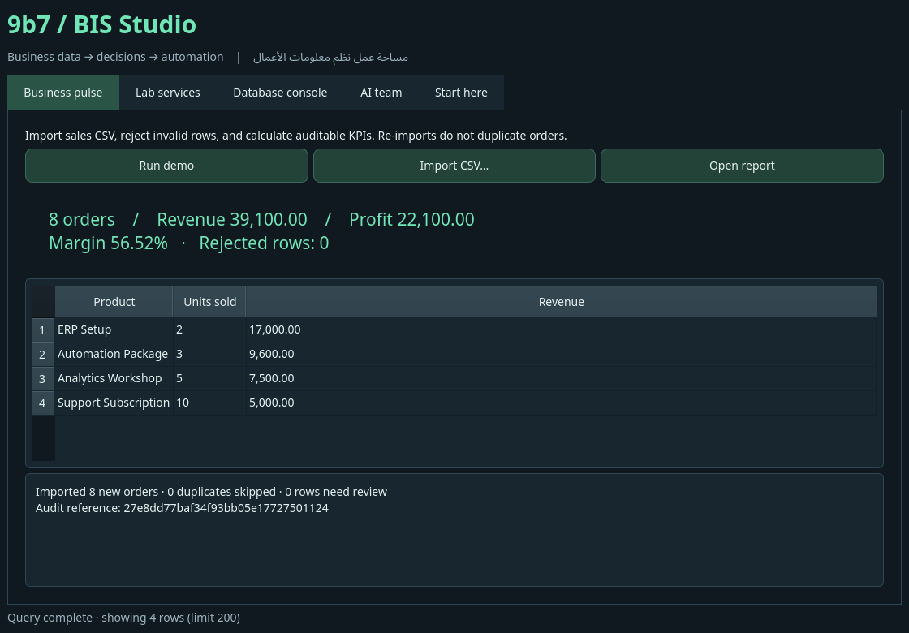

# 9b7 Linux · BIS graduation workspace

توزيعة Arch x86_64 مستهدفة للـUSB وVirtualBox، مع Hyprland وXFCE، وأدوات نظم معلومات الأعمال والذكاء الاصطناعي المحلي. الجهاز المستهدف **8GB RAM**؛ الخدمات الثقيلة تعمل عند الطلب.

**الحالة الحالية: ISO كامل بُني بحجم 11.5GiB واجتاز إقلاع BIOS وUEFI داخل QEMU؛ نشر ملفات التنزيل واختبار التثبيت ما زالا قيد الإكمال.** راجع [سجل التسليم](docs/HANDOFF.md) و[نتائج التحقق](docs/VALIDATION.md) قبل استكمال العمل. اسم المستخدم وكلمة مرور Linux الافتراضيان: **`9b7` / `9b7`**.

## ما صنعناه للمشروع

- **9b7 BIS Studio:** تطبيق Qt مكتبي لتحليل المبيعات، التقارير، إدارة المختبر، وحدة قواعد بيانات لستة محركات، ووكلاء AI.
- **9b7 Flow:** أداة أتمتة أصلية للاستيراد والتحقق وETL ومنع التكرار والتدقيق والتقارير، مع Inbox يعمل تلقائيًا.
- **AI team:** محلل → مخطط عمليات → مراجع، عبر Ollama/Qwen محلي؛ اقتراحات دون تنفيذ أوامر ذاتي.

المضمّن في ISO المبني: Firefox، VSCodium، Docker، DBeaver، Obsidian، Wireshark، Burp Community، Ansible، btop؛ وخدمات n8n، Apache Superset، Metabase، Odoo، ERPNext، PostgreSQL/Cassandra/Redis.



## جرّب أدوات المشروع الآن

```bash
python3 -m venv .venv
.venv/bin/pip install -e '.[desktop,databases]'
python3 -m nineb7.flow run data/demo-sales.csv --database /tmp/9b7-demo.sqlite3 --output /tmp/9b7-report
.venv/bin/9b7-studio
python3 -m unittest discover -s tests -v
bash scripts/check.sh
```

لا يحتاج Flow إلى حزم Python خارجية. Studio يحتاج PySide6 ومكتبات Qt الخاصة بالنظام. على Linux بدون شاشة استخدم `QT_QPA_PLATFORM=offscreen .venv/bin/python tests/gui_smoke.py` لاختبار الواجهة.

## المستندات

- [كيف تبني ISO وتشغّله على فلاشة أو VirtualBox](docs/BUILD.ar.md)
- [دليل الاستخدام والحسابات والاختصارات](docs/USER-GUIDE.ar.md)
- [تصميم مشروع BIS وخطة المناقشة](docs/PROJECT-BIS.ar.md)
- [النتائج الفعلية ومصفوفة قبول الإصدار](docs/VALIDATION.md)
- [نقطة استكمال أي أداة أو مطور](docs/HANDOFF.md)
- [مصادر البرمجيات وتراخيصها](docs/THIRD-PARTY.md)

`full` تشمل صور الخدمات ونموذج AI للاستخدام دون تنزيل. `desktop` تستهدف تجربة الإقلاع وتحتاج الإنترنت لأول تشغيل للخدمات. كلاهما يستخدم نفس profile؛ حزم وملفات البناء في `iso/` و`scripts/`. المخرجات الكبيرة في `out/` ولا تدخل Git.
