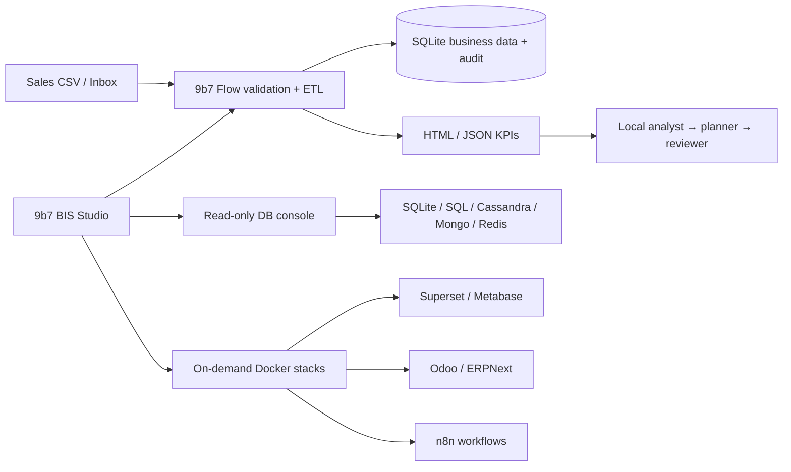

# إطار مشروع تخرج BIS

**الاسم المقترح:** 9b7 Business Intelligence & Automation Workspace.

**المشكلة:** طالب أو منشأة صغيرة يحتاج دورة متكاملة بين بيانات المبيعات، تقارير القرار، قواعد البيانات، أتمتة المهام وERP، بينما إعداد الأدوات ومتابعة جودة البيانات مشتتان.

**المساهمة الأصلية:** تطبيق ديسكتوب BIS Studio وأداة Flow. التوزيعة وسيلة تسليم قابلة للإقلاع وليست وحدها الجزء الأكاديمي. Omarchy مصدر إلهام لتجربة Hyprland؛ لم يُنسخ مثبت Omarchy لأنه يستهدف تثبيتًا مختلفًا عن Live ISO.

## دورة عرض 10–15 دقيقة

1. إقلاع ISO، الدخول بـ9b7، وشرح النظام ووحداته.
2. استيراد demo-sales.csv، عرض الإيراد والربح والهامش والمنتجات الأعلى.
3. إعادة نفس الاستيراد: إثبات منع التكرار. إضافة صف فاسد: عرض سجل الرفض. تعديل طلب موجود: إثبات كشف التعارض بدل كتابة بيانات صامتة.
4. تشغيل استعلام SQL من تطبيقنا ومقارنة الناتج بالتقرير.
5. وضع ملف في Inbox ومشاهدة ETL التلقائي والتقرير.
6. تشغيل خدمة BI واحدة أو n8n لعرض التكامل العملي. ERPNext عرضه منفصل على 8GB.
7. تشغيل الوكلاء المحليين ومراجعة توصياتهم مقابل الأرقام، مع شرح حدود AI.

## ما يُقدّم للجنة

- تحليل احتياجات وأصحاب مصلحة: مدير عمليات، محلل أعمال، مسؤول بيانات.
- Use cases: استيراد، كشف خطأ، مراجعة سجل، تحليل، استعلام، تشغيل workflow، إصدار تقرير.
- ERD لجدول orders وruns وrejections، وتصميم تدفق البيانات، وشرح حدود الثقة.
- مقارنة manual CSV processing بالـFlow: زمن الإجراء، معدل الخطأ، قابلية التتبع، عدد التكرارات الممنوعة.
- خطة اختبار تشمل بيانات صحيحة وفاسدة وتكرارًا وتعارضًا واستعادة تقرير وتعطل خدمة.
- سجل مساهمة الفريق ومراجع الأكواد والتراخيص، ونتائج الأداء الفعلية على جهاز 8GB.

## معمارية مختصرة

## حدود نطاق النسخة الحالية

نظام المبيعات يفترض عملة واحدة في dataset وصفًا واحدًا لكل order_id؛ لا يدّعي معالجة محاسبية كاملة أو فواتير متعددة البنود. ربط قاعدة الأعمال مباشرة بكل ERP أو كل لوحة BI يحتاج adapter ومخطط تكامل إضافيين؛ وجود الأدوات لا يعني أن هذا التكامل مُنجز. يُعرض هذا كعمل مستقبلي بدل ادعاء اكتماله.
