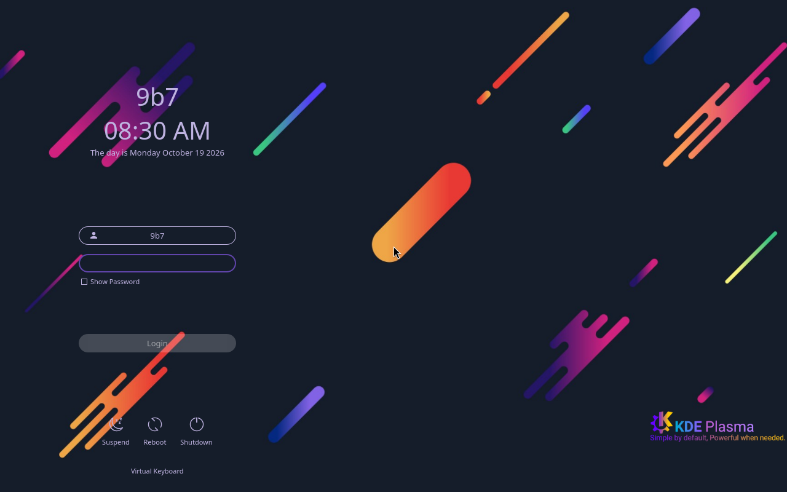
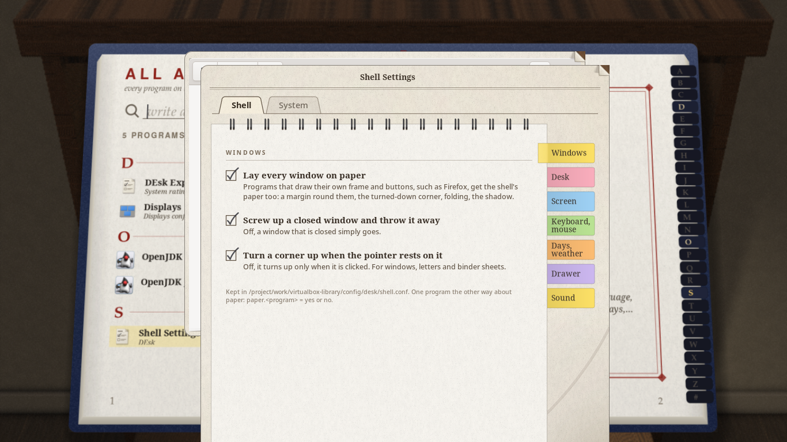
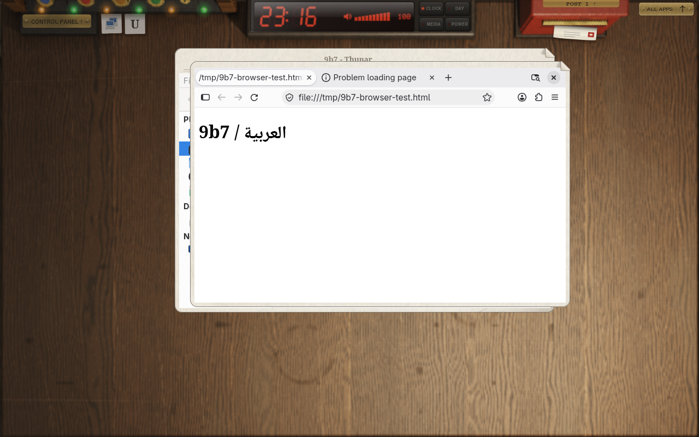

# نسخة VirtualBox الحالية

هذه هي نسخة التجارب النشطة: `virtualbox`، بواجهة **DEsk واحدة** ومؤثراتها الأصلية. ملفات Desktop القديمة وFull وبرامج 9b7 محفوظة في Git للإضافة لاحقًا؛ لا تدخل في هذه الصورة. التثبيت على الجهاز وUEFI وFull مؤجلة حتى موافقة المستخدم.

## البناء والتنزيل

افتح Actions → **VirtualBox ISO - DEsk preview** → Run workflow → main.
في Fork نفّذ Sync fork → Update branch أولًا، ثم شغّل بناءً جديدًا. إعادة تشغيل job قديم تستخدم كوده القديم.

بعد البناء وفحص SHA-256 يظهر Artifact باسم `virtualbox-iso-experimental-…` لمدة 3 أيام. نزّل ZIP وفكّه ثم اختر ISO في VirtualBox. لا تحتاج JOIN لهذا التحميل. قد يكون الملف موجودًا رغم فشل اختبار الإقلاع التالي؛ راجع Summary وصور الاختبار. Release العام، عند نجاح فحص QEMU، يحتوي أجزاء وJOIN وبصمات للتجميع والتحقق. اختبارات QEMU لا تعني أن VirtualBox اختُبر فعليًا.

## إعداد VirtualBox على جهاز 8GB RAM

- نوع النظام Arch Linux 64-bit، ذاكرة 4096MB، معالجان.
- VMSVGA، ذاكرة فيديو 128MB، **EFI مغلق**. هذه الصورة BIOS فقط.
- فعّل 3D لتجربة الرسومات الأصلية. إذا فشل برنامج تشغيل VirtualBox، عطّل 3D وأعد التشغيل؛ لا توجد جلسة ثانية تحتاج اختيارها.
- Scale Factor يساوي100%، وScaled Mode مغلق. اضبط الدقة من Display Settings داخل درج DEsk؛ لا تمدد صورة منخفضة الدقة إلى ملء الشاشة.
- اسم المستخدم وكلمة المرور: `9b7` / `9b7`. شاشة Slot-SDDM-6 الأصلية، دون قائمة جلسات.

DEsk v0.1.2 ليس مدير دخول؛ شاشة الباب الموجودة فيه شاشة قفل PAM داخل الجلسة. لذلك يبقى SDDM. لا تُفرض جودة 2D على الأجهزة القادرة على التسريع. يختار DEsk وضعه البرمجي عند اكتشاف CPU؛ وإذا فشل بدء الجلسة أو لم يصل لأول إطار خلال30ثانية، يحفظ wrapper السجل ويعيد المحاولة مرة واحدة بـpixman. لا يعالج هذا تلقائيًا كل أعطال العرض التي تقع بعد أول إطار.

## ما تحتويه الصورة

Firefox، Thunar، Foot، Mousepad، VSCodium، Docker/Compose، Ansible، DBeaver، Wireshark، Burp Suite Community، Obsidian، btop، وإعدادات العرض والصوت والشبكة. خدمات n8n وSuperset وMetabase وOdoo وERPNext وOllama وPostgreSQL/Cassandra/Redis لها مداخل في مكتبة البرامج وتكوينات مثبتة ببصمات صورها.

Hyprland وXFCE وLightDM وStudio وFlow وAI Hub وControl Center ومركز البرامج والمثبت الخاص غير موجودة في الصورة. وجود Thunar أو Mousepad ومكتباتهما لا يضيف جلسة XFCE.

الصور الكبيرة للحاويات والنماذج **تُنزّل عند الطلب** كما في Desktop السابقة؛ ليست ضمن ISO. لا يبدأ Docker أو ERP أو BI مع الإقلاع. شغّل خدمة ثقيلة واحدة فقط في هذه التجربة؛ ERPNext قد يحتاج ذاكرة تتجاوز المتاح عمليًا لضيف4GB. وجود التطبيق في القائمة لا يعني أن خدماته الثقيلة اختُبرت على هذا الحجم من الذاكرة.

لأن جلسة Live تستخدم RAM، تحتاج الحاويات إلى قرص بيانات ext4 دائم مركّب بالفعل، مع20GB فارغة على الأقل. الأمر التالي لا يقسّم ولا يهيّئ القرص:

```bash
sudo live-docker-storage /path/to/mounted-ext4
bis-service odoo start
bis-service odoo stop
bis-service erpnext logs
```

البيانات ومفاتيح الخدمات تبقى على هذا القرص؛ يلزم تركيبه وربطه مجددًا بعد إعادة تشغيل Live. `stop` يحافظ على volumes. لا تحتوي هذه النسخة مثبت نظام أو أداة تهيئة أقراص خاصة بنا. فتح خدمة من المكتبة يعرض الطرفية أثناء أول تنزيل، ثم يفتح المتصفح بعد نجاح فحصها الصحي. Ollama لا ينزّل نموذجًا تلقائيًا.

## التغييرات المطلوبة داخل DEsk

مصدر الواجهة وتراخيصه الأصلية محفوظة: `fyzugx/DEsk`، tag `v0.1.2`، commit `195435a09b9343e49b12e8dd8838a6e579a9aaa4`، MIT. لا يوجد إصدار مستقر أحدث عند فحص المصدر بتاريخ19أكتوبر2026؛ هذه نسخة beta.

- اسم كتاب Games أصبح `s` مع بقاء التصنيف الداخلي Games.
- في نسخة VirtualBox، فتح تطبيق من الكتاب يترك المكتبة والصفحة والبحث كما هي، والنافذة فوقها. النقر على المساحة الظاهرة من المكتبة يعيد التركيز إليها لفتح تطبيق آخر. `Super+A` يعيدك إلى المكتب عندما تختار ذلك.
- ظلت أدوات DEsk الأصلية والثيم والأصوات والقفل متاحة. أُبقي تحسين دقة المشهد البرمجي السابق من640 إلى1280 بكسل؛ أول تحضير للمشهد قد يأخذ وقتًا أطول، ولا يمكن مساواة أدائه بتسريع GPU.
- خلفية Plymouth الأصلية تستخدم ScaleBackgroundImage، دون استبدال الصور أو الأنيميشن.

قُلّل تأخير قائمة الإقلاع إلى ثانية، وحُضّر الحساب أثناء البناء، وأزيلت خدمات انتظار الشبكة وتجهيز البرامج عند أول إقلاع من هذه النسخة. القياسات الفعلية وحدود الاختبار موثقة بتاريخها في HANDOFF؛ لا نفترض تحسن الأداء قبل القياس.

## للمطور التالي

`iso/virtualbox/` هو profile مستقل بقائمة حزم صريحة، و`scripts/prepare-virtualbox-profile.sh` يدمج الثيمين وتكوينات الخدمات فقط من الملفات المشتركة. `scripts/build-iso.sh virtualbox` هو الأمر الافتراضي الآن. متغيرا `NINEB7_WORK_DIR` و`NINEB7_OUTPUT_DIR` يسمحان بالبناء خارج القرص الممتلئ دون حذف أي ISO قديم. البناء يحتاج Arch builder مخصصًا ومرجع Git نظيفًا.

راجع `docs/HANDOFF.md` قبل استكمال العمل، وسجّل أي اختبار لم يُنفّذ. لا تعد بناء Full قبل موافقة المستخدم.

## صور اختبارات19أكتوبر2026




الصورة الأولى من QEMU، والثانية من جلسة فعلية عبر Xvfb لاختبار الإدخال وترتيب النوافذ. لا تمثلان اختبار VirtualBox أو اعتماد أداء3D.

البناء يجهّز أيضًا كاش مشاهد DEsk الأصلية للرسم البرمجي عند800×600 و1024×768 و1280×800 و1366×768. هذه صور يولّدها محرك DEsk نفسه؛ لا تستبدل تصميمه ولا تمنع3D. الدقات أو مستويات الجودة الأخرى تعيد التحضير عند الحاجة. الفحص الآلي ينتظر اكتمال جميع مشاهد البيئة، وليس مجرد وجود عملية compositor.



النسخة المحلية من المصدر `d510805` حجمها 2.28GiB، واجتازت دورة QEMU BIOS كاملة بذاكرة4GB: الإقلاع، تسجيل الدخول، اكتمال المشاهد، ثم Firefox وThunar. اكتمل تحضير البيئة في38.4ثانية بعد بدء DEsk تحتTCG؛ لا تعتبره وقتًا متوقعًا على VirtualBox. القراءة من الكاش مؤكدة بالسجل، والتطبيقات الخاصة والواجهات الأخرى غير موجودة في الصورة. [البصمة والنتائج والقيود](VALIDATION.md) و[أدلة الاختبار](evidence/virtualbox-20261019/README.md).
