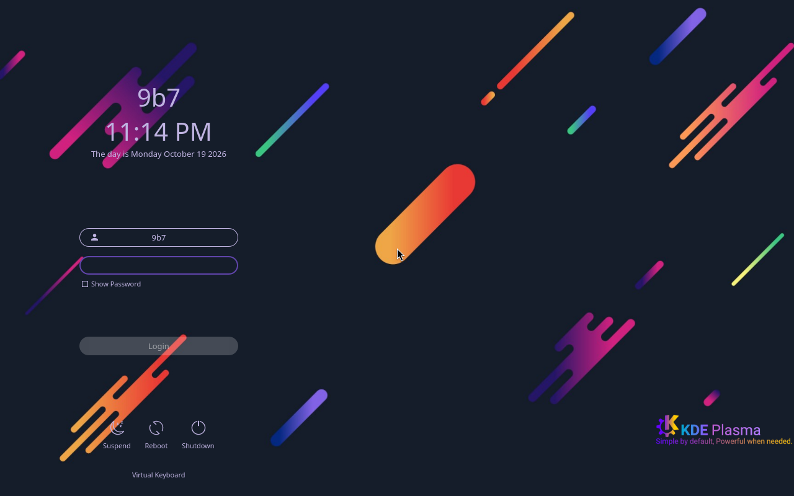
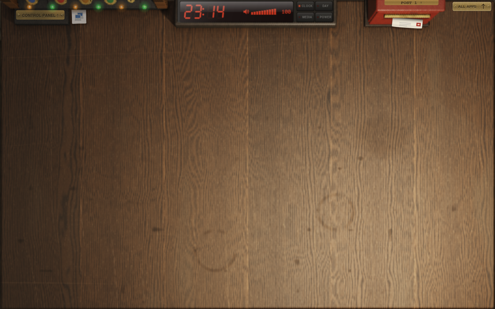

# VirtualBox profile: actual QEMU BIOS evidence

This directory records the local test of source `d510805` on 19 October 2026.
It is not an ISO download, a VirtualBox test, or a final release certificate.
The exact ISO size, checksum and build method are in [image.json](image.json).

The real test command, inside the Arch builder, was:

```bash
python /project/scripts/qemu-desktop-smoke.py \
  --iso /tmp/9b7-vbox-work/out-cached/9b7-linux-2026.10.19-x86_64-virtualbox.iso \
  --mode bios --edition virtualbox --boot-wait 120 \
  --output /project/work/virtualbox-qemu-cached --port 2241
```

QEMU used TCG, two CPUs, 4096MiB and std VGA. The test enabled SSH through the
real Live TTY, entered the password through SDDM, waited for all five DEsk
scene-ready markers, then launched Firefox and Thunar. It exited successfully.
The VM had no host disks or installation target attached.

- [result.json](result.json): test result, including untested areas.
- [session.txt](session.txt): renderer selection and complete scene preparation,
  including `room: read back 1280x804` and all five ready markers.
- [desktop.txt](desktop.txt): both processes and their compositor windows.
- [virtualbox-profile.txt](virtualbox-profile.txt): retained package versions
  and actual systemd startup measurements. All preceding profile assertions
  also passed, including one session and removal of the custom applications.
- [extra-checks.txt](extra-checks.txt): no failed system units at the sampled
  point, ldconfig's condition correctly skipped, memory, cache size and source.

Text evidence retains the command output, with trailing whitespace removed.

Actual unedited screenshots, reviewed after the run:






Firefox displays the local Arabic/English test page. Its additional first-run
tab reports a page-loading problem; external Internet was not verified.
The Xwayland log reports X0 already occupied, then correctly selects X1.
Bluetooth/battery warnings reflect this QEMU guest's missing devices.
The CPU renderer notification is expected without an accelerated GPU.

The separate [two-application library screenshot](../../images/virtualbox-20261019/library-two-apps.png)
and [manual return screenshot](../../images/virtualbox-20261019/manual-return.png)
come from a real Arch/Xvfb interaction test, not this boot run.

VirtualBox, hardware 3D, audible sound, lock/unlock, logout, installation,
UEFI and heavy services on a 4GB guest remain untested for this image.
Do not transfer passing results from older editions to this one.
